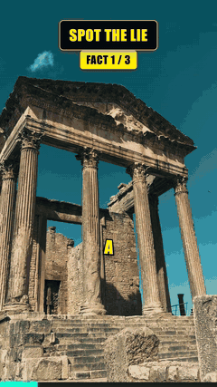
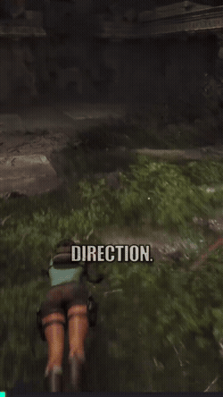
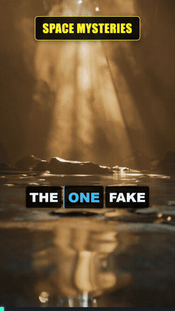
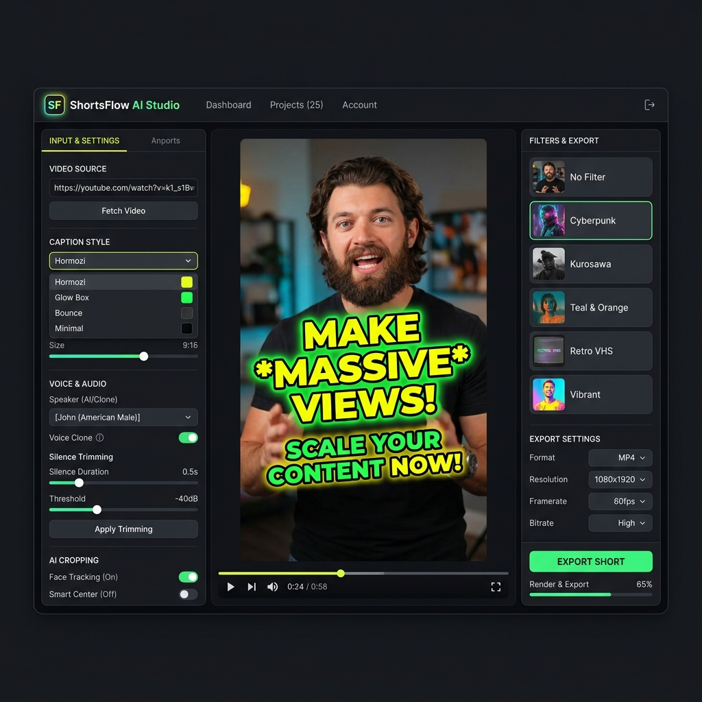

# ⚡ ShortsFlow AI Studio

> **The self-hosted Opus Clip alternative.**  
> Paste a podcast or YouTube link, get captioned 9:16 Shorts that cut to whoever is talking. Free, local, no watermark, no credit caps.

**Clip long videos** with local Whisper, an LLM that scores the hooks, face-tracked 9:16 crops, a stacked two-speaker split or active-speaker switching, and Remotion spring captions.
**Or generate from an idea** with 30+ formats (facts quizzes, explainers, top-5 lists, stories) and drive everything from a browser UI, the CLI, Docker, Colab or an MCP agent.

<div align="center">
  
  
  
  
</div>

<p align="center">
  🎬 <b>Running in production:</b> the YouTube channel <a href="https://www.youtube.com/@spottheliee">@spottheliee</a> is generated and posted
  entirely by ShortsFlow - 6 "spot the lie" Shorts a day from <a href=".github/workflows/daily_generate.yml">one GitHub Actions workflow</a>.
</p>

<p align="center">
  <a href="https://python.org"></a>
  <a href="https://remotion.dev"></a>
  <a href="https://nvidia.com"></a>
  <a href="LICENSE"></a>
  <a href="https://colab.research.google.com/github/ghost1412/shorts-generator/blob/main/ShortsFlow_Colab.ipynb"></a>
  <a href="https://github.com/ghost1412/shorts-generator/stargazers"></a>
  <a href="https://github.com/ghost1412/shorts-generator/actions/workflows/tests.yml"></a>
</p>

<p align="center"><b>⭐ If ShortsFlow saves you an Opus Clip subscription, please star the repo - it helps more creators find it.</b></p>

---

## ⚡ Quick Start - pick one

| Option | Command | Best for |
|---|---|---|
| ☁️ **Google Colab** (free GPU, zero install) | [](https://colab.research.google.com/github/ghost1412/shorts-generator/blob/main/ShortsFlow_Colab.ipynb) | Trying it in 5 minutes |
| 🐳 **Docker** (browser WebUI) | `docker run -p 7860:7860 -e GEMINI_API_KEY=your_key ghcr.io/ghost1412/shorts-generator` → open http://localhost:7860 | Servers, Linux, no Python setup |
| 🌐 **Browser WebUI** | `pip install -r requirements-full.txt && python webui.py` | Local use with a GPU |
| 🖥️ **Desktop Studio GUI** (Windows) | `setup.bat && launch.bat` | Windows desktop |
| 🤖 **AI agents** | `python mcp_server.py` or point your agent at [`SKILL.md`](SKILL.md) | Claude Code, Cursor, n8n |

```bash
git clone --depth 1 https://github.com/ghost1412/shorts-generator.git
cd shorts-generator
```

> 🐧 **Linux / macOS**: `chmod +x setup.sh && ./setup.sh && python3 webui.py`

---

## ⚡ ShortsFlow vs Opus Clip, Klap & Vizard

| | ⚡ ShortsFlow | Paid clippers |
|---|---|---|
| **Price** | Free (MIT). You pay only for the LLM key you choose, or $0 with Ollama | ~$19-49 / month with minute or credit caps |
| **Where your video goes** | Stays on your machine; Whisper runs locally | Uploaded to their cloud |
| **Watermark / export limits** | None | Watermark and caps on lower tiers |
| **Face-tracked 9:16 reframing** | ✅ | ✅ |
| **Podcast layouts** | ✅ single, stacked split, active-speaker switching | ✅ varies by tool |
| **Word-level animated captions** | ✅ Remotion (Hormozi, Glow Box, Bounce, Minimal) | ✅ |
| **Virality / hook score per clip** | ✅ in `--output_json` (WebUI view planned) | ✅ |
| **Dubbing** | ✅ | Often a paid add-on |
| **Idea-to-video (facts, explainers, stories)** | ✅ 30+ modes | ❌ clipping only |
| **Automation** | ✅ CLI, MCP server, Docker, GitHub Actions | API usually on higher tiers |
| **Polished timeline editor** | ❌ not yet | ✅ |
| **Multi-platform scheduling** | ✅ TikTok / Instagram / YouTube via Upload-Post (`python -m engine.publish`) | ✅ |

_Honest take: the paid tools have a nicer editor and scheduling. ShortsFlow wins on cost, privacy, and being scriptable._

---

## 🖥️ Desktop Studio GUI (`gui_app.py`)

<div align="center">
  
</div>

- **3-Column Single-Window Studio Layout**: Live 9:16 vertical canvas preview, mode picker, preset cards, and 1-click render launcher.
- **Interactive Remotion Presets**: 1-click selection between `HORMOZI`, `GLOW_BOX`, `BOUNCE`, and `MINIMAL` spring captions.

---

## 🎬 Video Generator Modes

| Mode | Visual Format | Quick Command |
| :--- | :--- | :--- |
| ✂️ **AI Clipping** | Slices long YouTube/local videos into high-scoring vertical shorts | `py main.py --source_video "URL" --smart_crop` |
| 🔢 **Top 5 Countdown** | Numbered listicle countdown shorts (#5 ➔ #1) with rank badges | `py main.py --mode TOP_5 --category "inventions"` |
| 💬 **Chat Story** | Animated text message conversation shorts (iMessage format) | `py main.py --mode CHAT_STORY --category "mystery"` |
| 👥 **Podcast** | 2-speaker debate shorts with alternating multi-voice synthesis | `py main.py --mode PODCAST --prompt "AI future"` |
| 🌐 **Video Dubbing** | Multilingual video translation & voice re-synthesis | `py main.py --mode DUB --source_video "clip.mp4" --target_lang es` |
| 🧮 **Manim Explainer** | Programmatic 2D/3D math, CS, and science animations | `py main.py --mode EXPLAINER --prompt "Gravity"` |
| 💡 **AI Facts** | High-energy trivia & mystery facts with scene stock loops | `py main.py --mode FACTS --category "space"` |
| 📖 **AI Story** | Narrative story voiceover with visual scene stitching | `py main.py --mode STORY --category "sci-fi"` |
| 🤔 **This or That (WYR)** | Split-screen dilemma challenge with VS central badge | `py main.py --mode WYR --category "superpowers"` |
| 🧩 **Emoji Guess** | Interactive emoji puzzle game with animated reveal | `py main.py --mode EMOJI_GUESS --category "movies"` |
| 📰 **News Breakdown** | RSS news headline summary with cartoon personas | `py main.py --mode NEWS --cartoon --persona mafia_cat` |

---

## 🎛️ Engine Power Capabilities

| Capability | Supported Technologies & Flags |
| :--- | :--- |
| 🎙️ **Voice Synthesis & Cloning** | Local Kokoro TTS (`--tts_provider kokoro`, no key), Zero-Shot Voice Cloning (`--clone_voice "sample.wav"`), VoiceStudio Local REST (`--tts_provider voicestudio`), ElevenLabs, EdgeTTS |
| 📐 **Aspect Ratios** | `9:16` (Vertical), `16:9` (Landscape), `1:1` (Square), `4:5` (Social Feed) via `--aspect_ratio` |
| 🔊 **Audio Mastering & SFX** | Auto SFX (`whoosh`, `pop`, `riser`, `boom`), Dynamic BGM Audio Ducking (`--auto_ducking`), Studio Master Filter (`--enhance_audio`) |
| 🎥 **Motion & Visual Filters** | Dynamic Camera Push-In Zoom (`--enable_zoom`), 12 Color Grade Presets (`--video_filter cyberpunk`, `kurosawa`, `teal_orange`) |
| 📦 **Batch Automation** | Automated queue execution from CSV / text lists (`--batch_file "topics.txt"`) |
| 🤖 **Multi-LLM Matrix** | Google Gemini, Local Ollama (`qwen3:8b`), DeepSeek, Groq, Anthropic, OpenRouter (`--llm_provider`) |

---

## 🎨 Visual Color Grading Presets (`--video_filter`)

| Preset Name | Visual Atmosphere | Preset Name | Visual Atmosphere |
| :--- | :--- | :--- | :--- |
| **`dynamic`** | AI auto-switches color grade per scene beat | **`kurosawa`** | Black & White high-contrast samurai |
| **`cyberpunk`** | Neon boosted purples/blues for night sci-fi | **`teal_orange`** | Blockbuster movie cinematic color balance |
| **`cinematic_warm`** | Golden hour warmth for scenery & drama | **`vibrant_action`** | Sharp contrast & saturation for sports/action |
| **`vintage_vhs`** | Analog retro tape scanlines & color shift | **`moody_dark`** | Dark fantasy / horror shadow contrast |

---

## 🤖 Model Context Protocol (MCP) & AI Agent Server

ShortsFlow AI Studio provides a native **MCP Server** (`mcp_server.py`) allowing AI assistants (Claude Desktop, Cursor, Antigravity, n8n, AutoGPT) to create shorts autonomously:

```bash
# Launch MCP Server over standard I/O for AI IDEs & Workflow Engines
python mcp_server.py
```

### Available MCP Tools:
* `generate_short`: Create AI shorts from topics or prompts.
* `extract_clips`: Slice long YouTube videos into vertical shorts with face tracking, a stacked two-speaker split (`layout: split`) or active-speaker switching (`layout: active`).
* `generate_social_package`: Generate platform metadata (`.meta.json`) for YouTube Shorts, TikTok, and Reels.
* `get_render_status`: Query live rendering job progress.

---

## 🔌 REST API & Webhooks

```bash
pip install -r requirements-full.txt
SHORTSFLOW_API_KEY=change-me python -m api        # http://127.0.0.1:8080/docs
```

```bash
curl -X POST localhost:8080/v1/clips -H "Authorization: Bearer change-me" -H "Content-Type: application/json"   -d '{"source_video": "https://youtu.be/VIDEO_ID", "layout": "active", "clip_count": 3, "webhook_url": "https://example.com/hook"}'
# -> {"id": "a1b2c3", "status": "queued", "url": "/v1/jobs/a1b2c3"}
curl localhost:8080/v1/jobs/a1b2c3 -H "Authorization: Bearer change-me"   # status + files[] download links
```

`POST /v1/shorts` generates from an idea (`mode`, `category`, `prompt`...). Webhooks are signed with
`X-ShortsFlow-Signature: sha256=<HMAC of body>` when `SHORTSFLOW_WEBHOOK_SECRET` is set. Jobs run one at a time by default
(`SHORTSFLOW_MAX_CONCURRENT`). With Docker: `SHORTSFLOW_API_KEY=change-me docker compose --profile api up api` (refuses to start without a key). A ready-made n8n flow lives in [`examples/n8n/`](examples/n8n/shortsflow-clip-workflow.json).

---

## 📤 Publish & Schedule (TikTok, Instagram Reels, YouTube Shorts)

Clip extraction writes `metadata.json` (title, description, tags) and a badge thumbnail next to every clip. Post them with
[Upload-Post](https://upload-post.com), which holds the platform logins (set `UPLOAD_POST_API_KEY` and `UPLOAD_POST_USER`):

```bash
# preview what would be posted, then post now or stagger one clip every 3 hours
python -m engine.publish sessions/extraction_123/metadata.json --platforms tiktok,instagram,youtube --dry-run
python -m engine.publish sessions/extraction_123/metadata.json --platforms tiktok,instagram --start 2026-11-02T10:00 --every 180 --timezone Europe/Madrid
```

---

## 🏷️ Brand Kit

Burn your logo, `@handle` and a closing end card into every clip (placed clear of the Shorts/Reels UI):

```bash
py main.py --source_video "URL" --logo logo.png --handle @mychannel --end_card "Follow for more"
py main.py --source_video "URL" --brand examples/brand.json      # same thing as a preset file
python -m engine.branding existing_clip.mp4 --logo logo.png --handle @mychannel   # any finished video
```

---

## 💡 Top Command Recipes

```bash
# 1. Podcast Shorts that cut to whoever is talking (stacked split when unsure) + silence removal
py main.py --source_video "https://www.youtube.com/watch?v=VIDEO_ID" --extract_mode shorts --layout active --tighten --use_remotion

# 1b. Prompt-based clipping: only the moments that match your request (LLM search, keyword fallback offline)
py main.py --source_video "https://www.youtube.com/watch?v=VIDEO_ID" --find "where they discuss pricing" --clip_count 3 --use_remotion

# 1c. Emoji pop on keywords in HORMOZI/BOUNCE captions (needs an emoji font; included in the Docker image)
py main.py --source_video "URL" --use_remotion --caption_style HORMOZI --caption_emoji

# 1d. Fully local, zero-cost voice: Kokoro TTS (no API key; ~120 MB model downloads once)
py main.py --mode FACTS --category "space" --tts_provider kokoro --voice af_heart --use_remotion

# 2. High-Retention Short with Voice Cloning, Zoom Motion & Audio Ducking
py main.py --mode FACTS --category "cyberpunk AI" --tts_provider voicestudio --clone_voice "my_voice.wav" --enable_zoom --auto_ducking --use_remotion

# 3. Render Landscape 16:9 YouTube Video with SFX
py main.py --mode EXPLAINER --prompt "Quantum physics" --aspect_ratio 16:9 --sfx_preset whoosh

# 4. Translate and Dub Video into Spanish
py main.py --mode DUB --source_video "https://www.youtube.com/watch?v=VIDEO_ID" --target_lang es --use_remotion

# 5. Process Batch Content Calendar Queue
py main.py --batch_file "topics.txt" --mode FACTS --aspect_ratio 9:16 --use_remotion
```

---

## ⚙️ Environment Configuration (`.env`)

Rename `env.example` to `.env`:

```env
GEMINI_API_KEY=your_gemini_key_here
HF_API_KEY=your_huggingface_key_here
PEXELS_API_KEY=your_pexels_key_here

# Local Voice Studio & Production Defaults
VOICE_PROVIDER=auto
VOICE_STUDIO_URL=http://localhost:8000/v1/audio/speech
DEFAULT_ASPECT_RATIO=9:16
AUTO_DUCKING=true
```

---

## 🤖 AI Agent Onboarding

If you are an AI Coding Agent (Cursor, Antigravity, Claude Code, Copilot, AutoGPT) onboarding into this codebase, see **[AGENTS.md](AGENTS.md)** for structured architectural context, module maps, CLI skills, and execution rules, and **[ROADMAP.md](ROADMAP.md)** for the open task board.

---

## ⭐ Star History

[](https://star-history.com/#ghost1412/shorts-generator&Date)

---

## 📄 License
ShortsFlow AI Studio is open-source software licensed under the MIT License.
