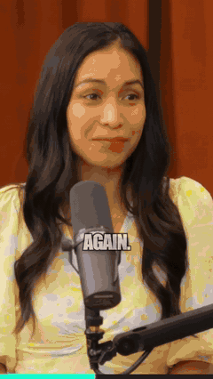
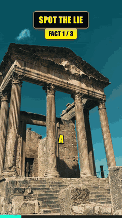
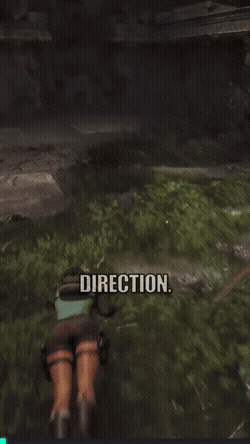
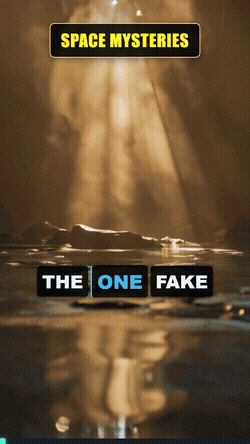
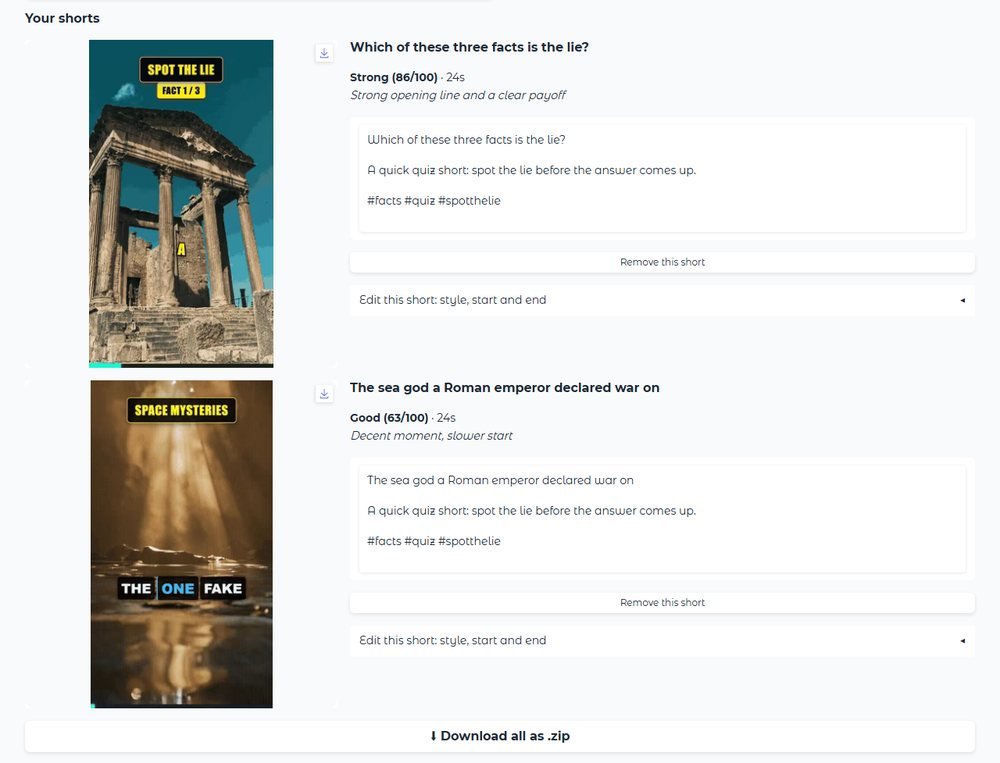
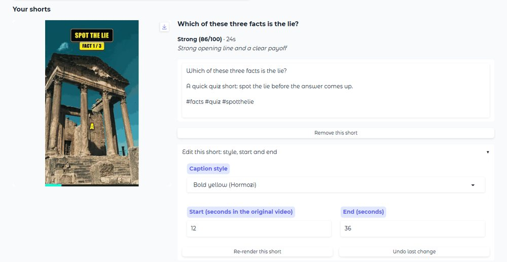
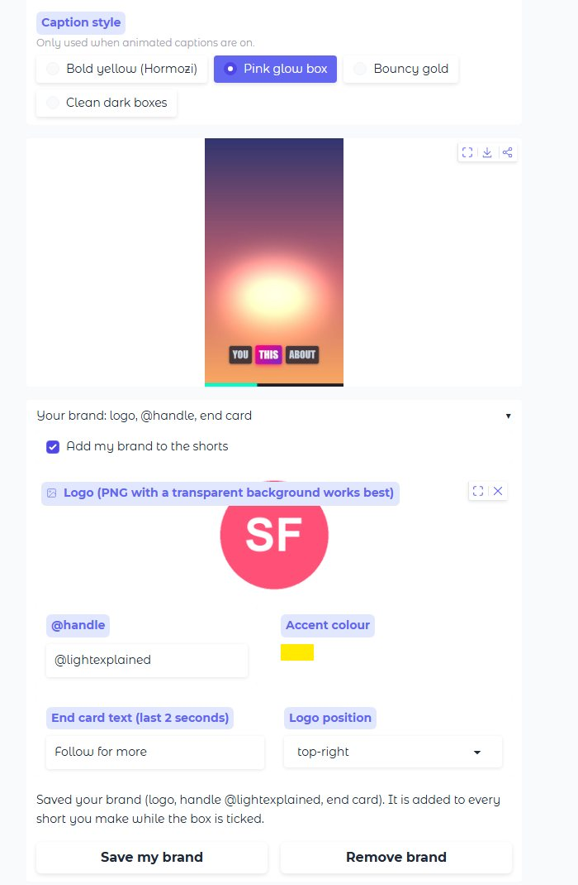
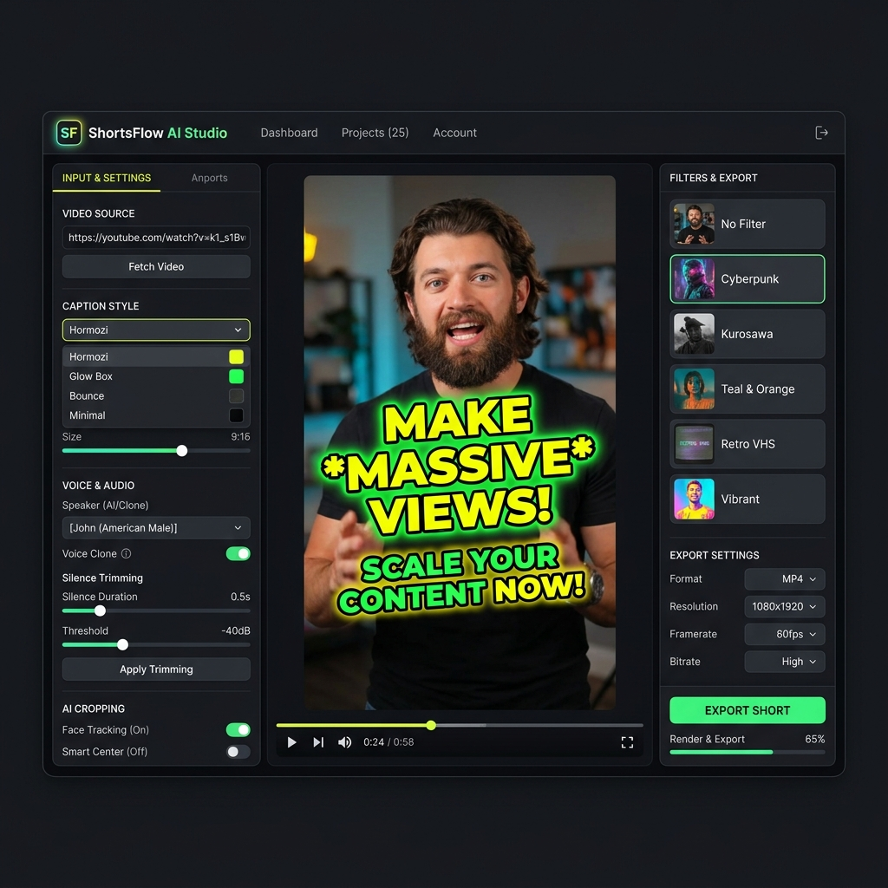

# ShortsFlow: full feature reference

> This is the complete reference that used to be the README: every mode, option, API and recipe. The short overview is in the [README](../README.md).


> **Turn a long video into captioned vertical Shorts, on your own PC.**
> The free, open-source alternative to Opus Clip, Klap and Vizard: no watermark, no credits, no subscription.
> **[Demo page](https://ghost1412.github.io/shortsflow/)** · one-click installer for Windows; Mac, Linux and Docker use the options below.

<div align="center">
  
  <br/>
  <sub>A real run: the 9:16 crop cuts to whoever is talking, with word-timed captions. <code>shortsflow clip interview.mp4 --captions</code></sub>
</div>

### Try it

| | |
|---|---|
| 🪟 **Windows, no setup** | [⬇ ShortsFlow-Setup.exe](https://github.com/ghost1412/shortsflow/releases/latest/download/ShortsFlow-Setup.exe) → open **ShortsFlow** → paste a link or drop a file → one button |
| 🍎🐧 **Mac or Linux, one line** | `curl -fsSL https://raw.githubusercontent.com/ghost1412/shortsflow/main/install.sh \| sh` (needs Python 3.10+ and FFmpeg; installs into `~/.shortsflow`, nothing else is touched) |
| 💻 **Any OS** | `pip install "shortsflow[clip]"` → `shortsflow doctor` → `shortsflow clip my_video.mp4` |
| ☁️ **Nothing to install** | [](https://colab.research.google.com/github/ghost1412/shortsflow/blob/main/ShortsFlow_Colab.ipynb) free GPU, nothing to install (run the cells, open the link it prints, log in with the password shown under it) |

No account or API key is needed to clip a video. A key (or a free local Ollama) only adds AI titles and descriptions.

### Why people use it

- **It finds the moments.** Local Whisper reads the speech, an AI scores the hooks, and every clip comes with the reason it was picked.
- **It frames the shot.** Face-tracked 9:16 crops, a cut to whoever is speaking, or a game-aware layout that keeps the HUD.
- **It styles the result.** Animated spring captions (Hormozi, glow box, bounce), your logo and handle, and an editor to re-cut any clip.
- **It stays on your PC.** Nothing leaves it unless you add an API key or turn on a cloud feature: Gemini/Groq (or another provider) for AI text, which receives the transcript text; Gemini for picture descriptions (`--visual_context`), which receives small frames; Microsoft's Edge voice service (or ElevenLabs) for computer voices in the dub and idea-to-video modes, which receives the text to speak; Google Drive upload. A pasted YouTube link is downloaded from YouTube to your PC. The one lookup that is on by default is the trip recap's place naming (rounded GPS to the free OpenStreetMap service); `--recap_no_geocode` turns it off. Choosing Ollama keeps the AI text on your PC.
- **It scales up.** Browser app, CLI, Docker, REST API, an MCP server for AI agents, and 30+ idea-to-video formats.

<p align="center">
  <a href="https://pypi.org/project/shortsflow/"></a>
  <a href="https://pypi.org/project/shortsflow/"></a>
  <a href="../LICENSE"></a>
  <a href="https://github.com/ghost1412/shortsflow/actions/workflows/tests.yml"></a>
  <a href="https://github.com/ghost1412/shortsflow/stargazers"></a>
  <a href="https://glama.ai/mcp/servers/ghost1412/shortsflow"></a>
  <a href="https://remotion.dev"></a>
  <a href="https://nvidia.com"></a>
</p>

<p align="center"><b>⭐ If ShortsFlow saves you an Opus Clip subscription, please star the repo - it helps more creators find it.</b></p>

<details>
<summary><b>More it can make</b> (idea-to-video formats, explainers, running in production)</summary>

<div align="center">
  
  
  
  
</div>

<p align="center">
  🎬 <b>Running in production:</b> the YouTube channel <a href="https://www.youtube.com/@spottheliee">@spottheliee</a> is generated and posted
  entirely by ShortsFlow - 6 Shorts a day from <a href="../.github/workflows/daily_generate.yml">one GitHub Actions workflow</a>.
</p>

</details>

---

## ✂️ Clipping demo: the crop follows whoever is talking

The first GIF above is a real run of `py main.py --source_video podcast.mp4 --layout active --use_remotion` on a two-person studio podcast
(a 1080p video): the crop follows the speaker, cuts to the host when she speaks (found by voice pitch plus face detection), and Whisper word
captions are burned in. The GIF is 14 seconds of one clip (four cuts between the two speakers), shrunk to 240 px wide, so the real MP4 is much sharper.
Source footage: [Lila Rose Podcast E143](https://www.youtube.com/watch?v=VIq8L_ZeqkA) by Lila Rose, shared on YouTube under the
[Creative Commons Attribution licence](https://creativecommons.org/licenses/by/3.0); the demo is a cropped, re-framed and captioned excerpt (changes made).

---

## 🧳 Recap demo: six clips become one video

<div align="center">
  
</div>

This is a real run of `py main.py --mode TRIP --trip_videos <6 clips> --recap_length 30 --recap_aspect 9:16 --auto_edit hype --transitions mix`
(the first 12 seconds). **It is not a best case:** the source is six free, widescreen (16:9) stock clips filmed by someone else, with no GPS and no
music, so there are no place names, and every shot sits small in the middle of the vertical frame with a blurred copy of itself above and below.
Vertical phone videos with GPS fill the frame instead and get named places.
Source footage: six videos by Poiana11 on Wikimedia Commons (`HoiAnMarket`, `HoiAn Market`, `Vietnam-HUE`, `VietnamBridge`, `TecnoVietnam`,
`TecnoWork&danceVietnam`), all marked [CC0](https://creativecommons.org/publicdomain/zero/1.0/).

---

## 📝 Step-by-step videos: a recipe, a DIY job, a workout, a tutorial

Write the steps in a text file, put your clips in step order (one folder per step, or one folder of clips in filming order) and ShortsFlow builds a vertical video that
opens on the finished result, goes straight into the steps with a title and a caption for each, and can end on a "what you need" card:

```
Title: Build a bird house
Hook: Done in one afternoon
Needs: 4 pine boards | 30 screws | wood glue | a drill
End: Ready to hang!

1. Cut the boards | Cut four 20 cm sides and two 15 cm roof pieces
2. Drill the hole | 3 cm hole, 12 cm above the floor
3. Assemble | Glue, then 6 screws per side
```

`py main.py --mode TRIP --trip_videos step1 step2 step3 --steps_file steps.txt --music song.mp3`

It uses a fast pace, a cinematic look, and keeps titles and captions in the part of the screen that Reels, Shorts and TikTok leave free; options you pass yourself win
(`--recap_speed 2` plays each step as a time-lapse, `--recap_ingredients_at start` puts the needs card first). Use `Ingredients:`, `Materials:` or `Tools:` instead of
`Needs:` to name the card. The music file is yours: with a song, the cuts follow its beat.

---

## 🎛️ Review, restyle and brand your shorts

No video handy? On the **Start here** tab, **Try a 2-minute sample** fills in a short public-domain NASA clip (credit: NASA, public domain). It is downloaded from GitHub (about 10 MB) only when you use it.

After **Make my shorts**, the browser app (`shortsflow webui`) shows every short as a card instead of a bare file list:

<div align="center">
  
</div>

- **Review:** a preview player, a *strong / good / okay / weak* label with the reason, and a title, description and hashtags ready to copy. Remove what you do not want, then **Download all as .zip**. Earlier runs can be reopened.
- **Edit one short:** pick another caption style or change its start and end, and only that short is re-rendered (about a minute). A timeline strip shows where the short sits in the source video (your other shorts in grey, cut words in red), and **Start/End -1 s / +1 s** buttons nudge the edges. **Undo** puts the previous version back.
- **Caption styles** come with a preview, and your **brand** (logo, @handle, end card, accent colour) is saved once and added to every short.

<div align="center">
  
  
</div>

<sub>Screenshots use sample clips made from the demo GIFs above.</sub>

---

## ⚡ Quick Start - pick one

## 🪟 Windows: one-click install

**[⬇ Download ShortsFlow-Setup.exe](https://github.com/ghost1412/shortsflow/releases/latest/download/ShortsFlow-Setup.exe)** (or see [all releases](https://github.com/ghost1412/shortsflow/releases)), run it, then open **ShortsFlow** from your Desktop. A browser page opens where you paste a video link or upload a file and press one button. No Python, Node or API key to install first.

- The installer downloads roughly 2 GB the first time (about 5 GB with an NVIDIA card, because of the GPU libraries; it fetches its own private Python, the speech-recognition components and Node), so it needs an internet connection and a few minutes. It does not need admin rights.
- It is not code-signed yet, so Windows may show a blue "Windows protected your PC" box: click **More info**, then **Run anyway**.
- With an NVIDIA graphics card it uses the GPU (fast). Without one it still works on the CPU, but transcribing a long video takes much longer, and the first run also downloads the speech model.
- Uninstall from Windows Settings > Apps. Your videos and settings in `%LOCALAPPDATA%\ShortsFlow\workspace` are kept.

## 🚀 Your first shorts in 3 steps (no API key needed)

Clipping a long video into vertical shorts works **without any account or API key**. A key (or a free local Ollama) only adds AI titles and descriptions, and is needed for the idea-to-video modes.

1. **Install** (needs [Python 3.12](https://python.org)): `pip install "shortsflow[clip]"`
2. **Check your setup**: `shortsflow doctor` lists what is ready and what to fix, in plain words.
3. **Make shorts** from a file or a link: `shortsflow clip my_video.mp4` (or `shortsflow clip "https://youtube.com/watch?v=..."`). Add `--count 5` for more clips, `--captions` for animated captions (needs [Node.js](https://nodejs.org), then run `shortsflow init` once).

Your shorts are saved in a `shortsflow` folder in your home directory (the command prints the exact path). Stuck? `shortsflow doctor` tells you the next step, and error messages say how to fix a bad key or a rate limit.

| Option | Command | Best for |
|---|---|---|
| ☁️ **Google Colab** (free GPU, zero install) | [](https://colab.research.google.com/github/ghost1412/shortsflow/blob/main/ShortsFlow_Colab.ipynb) | Trying it in 5 minutes |
| 🐳 **Docker** (browser WebUI) | `docker run -p 7860:7860 -e GEMINI_API_KEY=your_key ghcr.io/ghost1412/shortsflow` → open http://localhost:7860 | Servers, Linux, no Python setup |
| 📦 **pip** | `pip install shortsflow` then `shortsflow init` and `shortsflow doctor` (clipping: `pip install "shortsflow[clip]"`) | Using it as a command from anywhere |
| 🌐 **Browser WebUI** | `pip install -r requirements-full.txt && python webui.py` | Local use with a GPU |
| 🖥️ **Desktop Studio GUI** (Windows) | `setup.bat && launch.bat` | Windows desktop |
| 🤖 **AI agents** | `python mcp_server.py` or point your agent at [`SKILL.md`](../SKILL.md) | Claude Code, Cursor, n8n |

```bash
git clone --depth 1 https://github.com/ghost1412/shortsflow.git
cd shortsflow
```

> 🐧 **Linux / macOS**: the easy route is the one-line installer, no clone needed: `curl -fsSL https://raw.githubusercontent.com/ghost1412/shortsflow/main/install.sh | sh` (installs into `~/.shortsflow`; needs Python 3.10+ and FFmpeg). From a clone: `chmod +x setup.sh && ./setup.sh && python3 webui.py`

---

## 🖼️ Demo gallery

All GIFs are real renders from this repository.

<div align="center">
  
  
  
  
  
</div>

| GIF | What it shows |
| :--- | :--- |
| `demo_podcast_cuts.gif` | Long interview clipped with `--layout active`: the shot cuts to whoever is speaking, with word captions |
| `demo_recap.gif` | Trip recap from six widescreen CC0 stock clips (not a best case: letterboxed, no GPS or music): hook, title cards, fast cuts |
| `demo_game.gif` | `--content game`: a cutscene clip with captions, then a car chase, whole picture kept in frame (not a best case: small picture, blurred bars) |
| `demo_spot_the_lie.gif` | The "Spot the Lie" quiz format that runs the daily YouTube channel |
| `demo_short.gif` | Idea-to-video short with spring captions |
| `demo_facts.gif` | `--mode FACTS` trivia short |
| `demo_explainer.gif` | `--mode EXPLAINER` Manim animation |

---

## ⚡ ShortsFlow vs Opus Clip, Klap & Vizard

| | ⚡ ShortsFlow | Paid clippers |
|---|---|---|
| **Price** | Free (MIT). You pay only for the LLM key you choose, or $0 with Ollama | ~$19-49 / month with minute or credit caps |
| **Where your video goes** | Stays on your machine; Whisper runs locally (text goes to an AI provider only if you add a key) | Uploaded to their cloud |
| **Watermark / export limits** | None | Watermark and caps on lower tiers |
| **Face-tracked 9:16 reframing** | ✅ | ✅ |
| **Podcast layouts** | ✅ single, stacked split, active-speaker switching | ✅ varies by tool |
| **Word-level animated captions** | ✅ Remotion (Hormozi, Glow Box, Bounce, Minimal) | ✅ |
| **Virality / hook score per clip** | ✅ strong / good / okay / weak label with the reason on the review screen, raw score in `--output_json` | ✅ |
| **Review screen, copy-ready title / description / hashtags** | ✅ browser app | ✅ |
| **Edit one short (caption style, start / end, undo)** | ✅ browser app; not a frame-accurate timeline | ✅ fuller editors |
| **Brand kit (logo, @handle, end card, accent colour)** | ✅ | Usually on paid tiers |
| **Prompt-based clipping ("only where they discuss pricing")** | ✅ `--find` (LLM search, keyword fallback offline) | Varies by tool |
| **Edit by transcript (cut phrases, remove ums / uhs)** | ✅ `--cut`, `--edit_transcript`, `--remove_fillers` | Varies by tool |
| **Caption languages** | ✅ Latin, Cyrillic, Greek, Devanagari, Arabic and Chinese / Japanese / Korean (CJK fonts download once on first use), optional translation (`--caption_lang`) | Many languages |
| **Dubbing / translated voice-over** | ✅ basic (`--mode DUB`: one synthetic voice per language, no voice cloning, no lip-sync) | Often a paid add-on, with voice cloning |
| **Idea-to-video (facts, explainers, stories)** | ✅ 30+ modes | ❌ clipping only |
| **Automation** | ✅ CLI, REST API, MCP server, Docker, GitHub Actions | API usually on higher tiers |
| **Polished timeline editor** | ❌ | ✅ |
| **Multi-platform scheduling** | ⚠️ TikTok / Instagram / YouTube via Upload-Post (`python -m engine.publish`); only tested against mocks, not a live account | ✅ |
| **Setup** | One-click Windows installer or `pip install shortsflow`; CPU works but is slow, an NVIDIA GPU is much faster | Open a browser tab |

_Honest take: the paid tools have a nicer editor, hosted convenience and tested scheduling. ShortsFlow wins on cost, privacy, and being scriptable. Competitor columns describe typical offerings and change often; check their current pricing and features._

---

## 🖥️ Desktop Studio GUI (`gui_app.py`)

<div align="center">
  
</div>

- **3-Column Single-Window Studio Layout**: Live 9:16 vertical canvas preview, mode picker, preset cards, and 1-click render launcher.
- **Interactive Remotion Presets**: 1-click selection between `HORMOZI`, `GLOW_BOX`, `BOUNCE`, and `MINIMAL` spring captions.

---

## 🎬 Video Generator Modes

| Mode | Visual Format | Quick Command |
| :--- | :--- | :--- |
| ✂️ **AI Clipping** | Slices long YouTube/local videos into high-scoring vertical shorts | `py main.py --source_video "URL" --smart_crop` |
| 🔢 **Top 5 Countdown** | Numbered listicle countdown shorts (#5 ➔ #1) with rank badges | `py main.py --mode TOP_5 --category "inventions"` |
| 💬 **Chat Story** | Animated text message conversation shorts (iMessage format) | `py main.py --mode CHAT_STORY --category "mystery"` |
| 👥 **Podcast** *(planned, not implemented yet)* | 2-speaker debate shorts with alternating multi-voice synthesis | - |
| 🌐 **Video Dubbing** *(basic)* | Transcribes, translates per sentence, re-voices with edge-tts (needs internet; Kokoro for English), ducks the original audio, writes translated `.srt` (`--dub_captions` burns it in, with a font that has the glyphs for Hindi, Arabic, Cyrillic and CJK). One voice for everyone (`--dub_voice male|female|<edge-tts name>`), no lip-sync or voice cloning | `py main.py --mode DUB --source_video talk.mp4 --target_lang es` |
| 📸 **Photo reels** | Give 3+ photos and pick a type (memories, travel recap, product showcase, then vs now, top-N countdown, tribute): it skips blurry and duplicate photos, orders them (by photo date for memories/travel), times them, writes the captions, title and closing line, and renders a 9:16 reel with music. Works with no key. Browser app: the Photo reel tab | `py main.py --mode PHOTO_REEL --photos_dir photos --reel_type travel --prompt "Lisbon"` |
| 🧮 **Manim Explainer** | Programmatic 2D/3D math, CS, and science animations | `py main.py --mode EXPLAINER --prompt "Gravity"` |
| 💡 **AI Facts** | High-energy trivia & mystery facts with scene stock loops | `py main.py --mode FACTS --category "space"` |
| 📖 **AI Story** | Narrative story voiceover with visual scene stitching | `py main.py --mode STORY --category "sci-fi"` |
| 🤔 **This or That (WYR)** | Split-screen dilemma challenge with VS central badge | `py main.py --mode WYR --category "superpowers"` |
| 🧩 **Emoji Guess** | Interactive emoji puzzle game with animated reveal | `py main.py --mode EMOJI_GUESS --category "movies"` |
| 📰 **News Breakdown** | RSS news headline summary with cartoon personas | `py main.py --mode NEWS --cartoon --persona mafia_cat` |

---

## 🎛️ Engine Power Capabilities

| Capability | Supported Technologies & Flags |
| :--- | :--- |
| 🎙️ **Voice Synthesis & Cloning** | Local Kokoro TTS (`--tts_provider kokoro`, no key), Zero-Shot Voice Cloning (`--clone_voice "sample.wav"`), VoiceStudio Local REST (`--tts_provider voicestudio`), ElevenLabs, EdgeTTS |
| 📐 **Aspect Ratios** | 9:16 vertical shorts (the default), 16:9 for the highlights video. `--aspect_ratio` values other than 9:16 are not implemented yet and print a warning |
| 🔊 **Audio & sound effects** | `--clean_audio` (noise reduction + loudness to about -14 LUFS; `--enhance_audio` is the same), soft whooshes / pops / hits under zooms, cutaways and the teaser cut with `--auto_edit`. `--auto_ducking` and `--sfx_preset` are not implemented yet |
| 🎥 **Motion & Visual Filters** | Punch-in zooms on emphasised words (`--auto_zoom`, also `--enable_zoom`), stock cutaways (`--broll`), 12 colour grade presets (`--video_filter cyberpunk`, `kurosawa`, `teal_orange`) |
| 📦 **Batch Automation** | Automated queue execution from CSV / text lists (`--batch_file "topics.txt"`) |
| 🌍 **Caption Languages** | Latin, Cyrillic (ru, uk, bg), Greek and Devanagari captions; `--caption_lang es` translates captions with your AI provider and keeps them timed |
| 🧭 **Layouts** | `--layout auto` picks per clip: cut-to-speaker for two-person shots, tracked single crop otherwise; also `active`, `stacked`; `fit` shows the whole landscape picture centred over a blurred copy (nothing cropped off the sides) |
| 🎞️ **Highlights Video** | One landscape video of the best moments, any length, from the browser app |
| 🎬 **Auto-edit director** | `--auto_edit podcast|hype|educational|vlog` with `--edit_strength subtle|medium|hyped`: one choice turns on the right mix of pause/um cuts, captions, zooms, cutaways, a teaser opening, colour and sound effects. Writes `edit_plan.json` and shows what it did on each clip |
| 🪝 **Cold open** | `--cold_open` starts each short with its strongest line as a 1.5-6 s teaser, then plays the clip from the beginning (captions and subtitles stay in sync) |
| 👁️ **Story-aware picking** | `--visual_context` lets a vision model look at a few frames of each candidate, so the story on screen counts and not only what the speaker says (great for gameplay, cutscenes, film recaps). With `GEMINI_API_KEY` set it uses Gemini (small frames are sent to Google; best descriptions, no GPU load); otherwise a local Ollama model (`ollama pull gemma3:12b`, nothing leaves your PC). `SHORTSFLOW_VISION=ollama` forces local. `--user_context "God of War 3 story playthrough"` tells the AI what the video is about. Skipped with a note if neither is available |
| 🧳 **Trip recap** | Several travel videos in order become one recap: a hook over the most beautiful shots, then the whole trip day by day or stop by stop with title cards, a closing card, plus a written itinerary (`--mode TRIP`, or the Trip recap tab). It reads the GPS your phone stored in each video to tell the places apart and name them as tourist attractions (lakes, canyons, viewpoints; the coordinates go to the free OpenStreetMap service, `--recap_no_geocode` keeps them on your PC). The same scene is never shown twice, and with `--visual_context` clips stored sideways are turned upright. `--recap_versions both` makes a portrait and a landscape version |
| 🎨 **Auto-enhance** | `--enhance auto` (shorts and the trip recap; tick-boxes in the browser app) corrects each video like an editor before styling it: lifts dark clips, tones down very bright ones, reduces a clear colour cast, adds a little colour and sharpness to dull clips, light denoise on dark noisy ones. Each video is measured and only corrected where needed; vivid sunsets and lakes are left alone. Local, FFmpeg only; it cannot add detail that is not in the footage |
| ♻️ **Reuse an earlier run** | In the browser app, pick an earlier run (Start here or Trip recap), change any setting and start: the transcript, chosen moments, picture descriptions and cut pieces are reused, so only the final rendering is done again. Choose "Skip transcription only" to pick the moments again (needed when you change the clip count, length or layout) |
| ☁️ **Upload to Google Drive** | `--upload_drive <folder link>` with `--mode TRIP`, `python -m engine.drive_upload FILE --folder <link>`, or the optional Drive box in the browser app. One-time Google sign-in set-up is described at the top of `engine/drive_upload.py` |
| 🎯 **Smarter clip picking** | Clips start and end on sentence boundaries (`--no_snap` to disable), repeated moments are skipped (`--no_diversity`), one LLM request ranks all candidates with context (`--no_rerank`), pace changes and laughter count a little (`--no_signals`) |
| 📸 **Photo reels** | `--mode PHOTO_REEL --reel_type memories|travel|product|then_now|countdown|tribute`: skips blurry and duplicate photos, orders, times and captions them |
| 🤖 **Multi-LLM Matrix** | Google Gemini, Local Ollama (`qwen2.5:7b`), DeepSeek, Groq, Anthropic, OpenRouter (`--llm_provider`) |

---

## 🎨 Visual Color Grading Presets (`--video_filter`)

| Preset Name | Visual Atmosphere | Preset Name | Visual Atmosphere |
| :--- | :--- | :--- | :--- |
| **`dynamic`** | AI auto-switches color grade per scene beat | **`kurosawa`** | Black & White high-contrast samurai |
| **`cyberpunk`** | Neon boosted purples/blues for night sci-fi | **`teal_orange`** | Blockbuster movie cinematic color balance |
| **`cinematic_warm`** | Golden hour warmth for scenery & drama | **`vibrant_action`** | Sharp contrast & saturation for sports/action |
| **`vintage_vhs`** | Analog retro tape scanlines & color shift | **`moody_dark`** | Dark fantasy / horror shadow contrast |

---

## 🤖 Model Context Protocol (MCP) & AI Agent Server

ShortsFlow AI Studio provides a native **MCP Server** (`mcp_server.py`) allowing AI assistants (Claude Desktop, Cursor, Antigravity, n8n, AutoGPT) to create shorts autonomously:

Listed in the [Glama MCP directory](https://glama.ai/mcp/servers/ghost1412/shortsflow) (its quality score is the Glama badge at the top of this page).

```bash
# Launch MCP Server over standard I/O for AI IDEs & Workflow Engines
python mcp_server.py
```

### Add it to your AI tool

The MCP server runs from a checkout of this repo (it starts `main.py` next to it):

```bash
git clone --depth 1 https://github.com/ghost1412/shortsflow.git
cd shortsflow && pip install -r requirements.txt
claude mcp add shortsflow -- python /full/path/to/shortsflow/mcp_server.py      # Claude Code
```

Claude Desktop / Cursor: add this under `mcpServers` in the tool's config JSON (use the full path):

```json
{ "mcpServers": { "shortsflow": { "command": "python", "args": ["/full/path/to/shortsflow/mcp_server.py"] } } }
```

### Available MCP Tools:
* `generate_short`: Create AI shorts from topics or prompts.
* `extract_clips`: Slice long YouTube videos into vertical shorts with face tracking, a stacked two-speaker split (`layout: split`) or active-speaker switching (`layout: active`).
* `generate_social_package`: Generate platform metadata (`.meta.json`) for YouTube Shorts, TikTok, and Reels.
* `get_render_status`: Query live rendering job progress.
* `list_supported_modes`: List the content modes, caption styles and options the server accepts.

---

### Defaults differ by surface (on purpose)

The same clipping job starts from different defaults depending on where you launch it, so pass the flag you want explicitly when it matters:

| | face-tracking crop | cut silences | animated captions | clips | length |
|---|---|---|---|---|---|
| `python main.py` | off | off | off | 5 | 30 s |
| `shortsflow clip` | on | on | off (`--captions`) | 3 | 30 s |
| Browser app, Clip tab | on | on | on | 3 | 30 s |
| REST API (`/v1/clips`) | on | off | on | 3 | 45 s |
| MCP `extract_clips` | on | on | on | 3 | 30 s |

Shorts are never longer than 60 s; the API now rejects a longer `target_duration` instead of silently capping it.

## 🔌 REST API & Webhooks

```bash
pip install -r requirements-full.txt
SHORTSFLOW_API_KEY=change-me python -m shortsflow.api        # http://127.0.0.1:8080/docs
```

```bash
curl -X POST localhost:8080/v1/clips -H "Authorization: Bearer change-me" -H "Content-Type: application/json"   -d '{"source_video": "https://youtu.be/VIDEO_ID", "layout": "active", "clip_count": 3, "webhook_url": "https://example.com/hook"}'
# -> {"id": "a1b2c3", "status": "queued", "url": "/v1/jobs/a1b2c3"}
curl localhost:8080/v1/jobs/a1b2c3 -H "Authorization: Bearer change-me"   # status + files[] download links
```

Set `SHORTSFLOW_API_KEY` before exposing the API beyond localhost; webhook URLs pointing at private addresses are rejected unless `SHORTSFLOW_ALLOW_PRIVATE_WEBHOOKS=1`.

`POST /v1/shorts` generates from an idea (`mode`, `category`, `prompt`...). Webhooks are signed with
`X-ShortsFlow-Signature: sha256=<HMAC of body>` when `SHORTSFLOW_WEBHOOK_SECRET` is set. Jobs run one at a time by default
(`SHORTSFLOW_MAX_CONCURRENT`). With Docker: `SHORTSFLOW_API_KEY=change-me docker compose --profile api up api` (refuses to start without a key). A ready-made n8n flow lives in [`examples/n8n/`](../examples/n8n/shortsflow-clip-workflow.json).

---

## 📤 Publish & Schedule (TikTok, Instagram Reels, YouTube Shorts)

Clip extraction writes `metadata.json` (title, description, tags) and a badge thumbnail next to every clip. Post them with
[Upload-Post](https://upload-post.com), which holds the platform logins (set `UPLOAD_POST_API_KEY` and `UPLOAD_POST_USER`):

```bash
# preview what would be posted, then post now or stagger one clip every 3 hours
python -m engine.publish sessions/extraction_123/metadata.json --platforms tiktok,instagram,youtube --dry-run
python -m engine.publish sessions/extraction_123/metadata.json --platforms tiktok,instagram --start 2026-11-02T10:00 --every 180 --timezone Europe/Madrid
```

---

## 🏷️ Brand Kit

Burn your logo, `@handle` and a closing end card into every clip (placed clear of the Shorts/Reels UI):

```bash
py main.py --source_video "URL" --logo logo.png --handle @mychannel --end_card "Follow for more"
py main.py --source_video "URL" --brand examples/brand.json      # same thing as a preset file
python -m engine.branding existing_clip.mp4 --logo logo.png --handle @mychannel   # any finished video
```

---

## 💡 Top Command Recipes

```bash
# 1. Podcast Shorts that cut to whoever is talking (stacked split when unsure) + silence removal
py main.py --source_video "https://www.youtube.com/watch?v=VIDEO_ID" --extract_mode shorts --layout active --tighten --use_remotion

# 1b. Prompt-based clipping: only the moments that match your request (LLM search, keyword fallback offline)
py main.py --source_video "https://www.youtube.com/watch?v=VIDEO_ID" --find "where they discuss pricing" --clip_count 3 --use_remotion

# 1a. Cut the ums and uhs (and silences) out of clips
py main.py --source_video "URL" --tighten --remove_fillers --use_remotion

# 1e. Edit by transcript: cut phrases, or delete words from the transcript text file and re-run
py main.py --source_video "URL" --session_dir sessions/talk --cut "you know" --cut "so basically"
#   -> writes sessions/talk/transcript.txt; delete words/lines in a copy, then:
py main.py --source_video "URL" --session_dir sessions/talk --edit_transcript my_edit.txt

# 1c. Emoji pop on keywords in HORMOZI/BOUNCE captions (needs an emoji font; included in the Docker image)
py main.py --source_video "URL" --use_remotion --caption_style HORMOZI --caption_emoji

# 1d. Fully local, zero-cost voice: Kokoro TTS (no API key; ~120 MB model downloads once)
py main.py --mode FACTS --category "space" --tts_provider kokoro --voice af_heart --use_remotion

# 2. High-Retention Short with Voice Cloning & Zoom Motion
py main.py --mode FACTS --category "cyberpunk AI" --tts_provider voicestudio --clone_voice "my_voice.wav" --enable_zoom --use_remotion

# 3. Educational explainer (Manim)
py main.py --mode EXPLAINER --prompt "Quantum physics" --skip-upload

# 4. Translate and dub a video (basic: one synthetic voice, no cloning; --language auto if the source is not English)
py main.py --mode DUB --source_video talk.mp4 --target_lang es --dub_captions

# 5. Process Batch Content Calendar Queue
py main.py --batch_file "topics.txt" --mode FACTS --use_remotion
```

---

## ⚙️ Environment Configuration (`.env`)

Rename `env.example` to `.env`:

```env
GEMINI_API_KEY=your_gemini_key_here
HF_API_KEY=your_huggingface_key_here
PEXELS_API_KEY=your_pexels_key_here

# Local Voice Studio & Production Defaults
VOICE_PROVIDER=auto
VOICE_STUDIO_URL=http://localhost:8000/v1/audio/speech
DEFAULT_ASPECT_RATIO=9:16
AUTO_DUCKING=true
```

---

## 🤖 AI Agent Onboarding

If you are an AI Coding Agent (Cursor, Antigravity, Claude Code, Copilot, AutoGPT) onboarding into this codebase, see **[AGENTS.md](../AGENTS.md)** for structured architectural context, module maps, CLI skills, and execution rules, and **[ROADMAP.md](../ROADMAP.md)** for the open task board.

To measure clip quality before and after a change, run `python scripts/clip_benchmark.py <session_dir> [--picture]` on a finished run: it reports whether clips start and end on a sentence, overlap, spread across the video and have titles that name nothing the clip does not say; `--picture` also checks the clip videos (face found, face centred, crop jitter, silence). No LLM or network needed.

---

## 🐞 Report a problem

Something broke? [Open an issue](https://github.com/ghost1412/shortsflow/issues/new/choose) and paste the output of `shortsflow doctor` (it prints no keys). For installer problems also attach `install.log` from the install folder.

## ⭐ Star History

[](https://star-history.com/#ghost1412/shortsflow&Date)

---

## 📄 License
ShortsFlow AI Studio is open-source software licensed under the MIT License.

The optional animated-caption renderer uses [Remotion](https://www.remotion.dev), which has its own source-available licence (free for individuals and small teams; see [remotion.dev/license](https://www.remotion.dev/license) if you are a larger company). Without Node.js/Remotion you still get clips, just without the animated captions.
