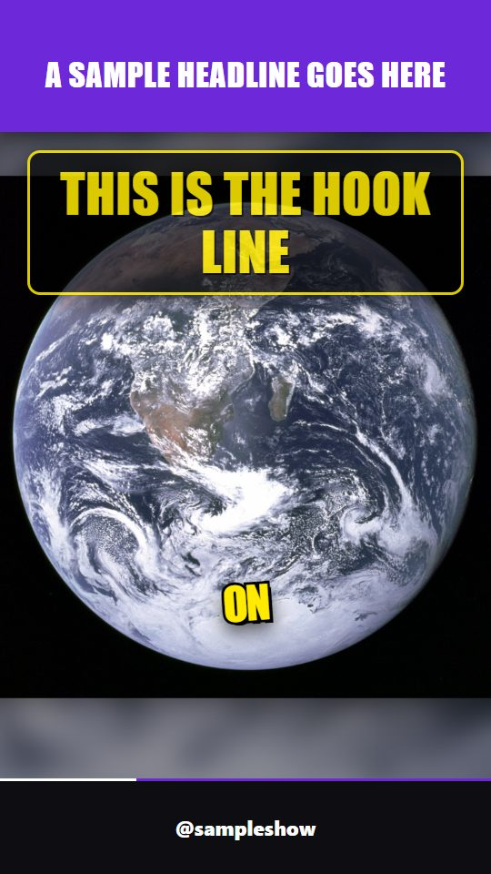
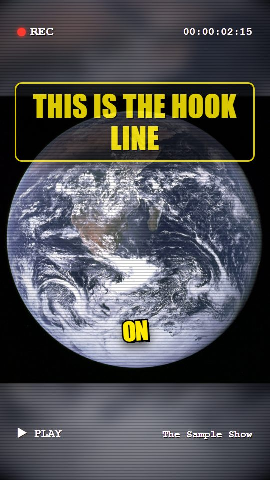
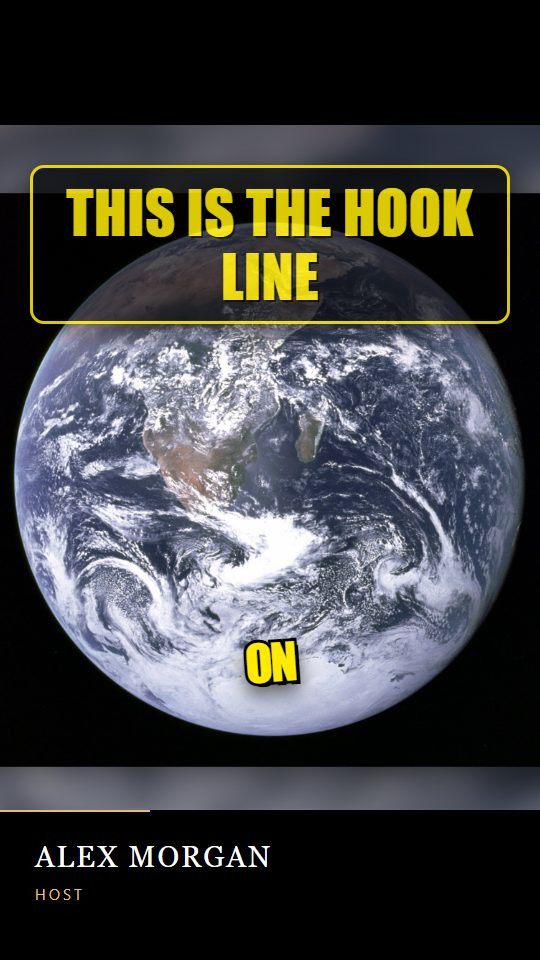
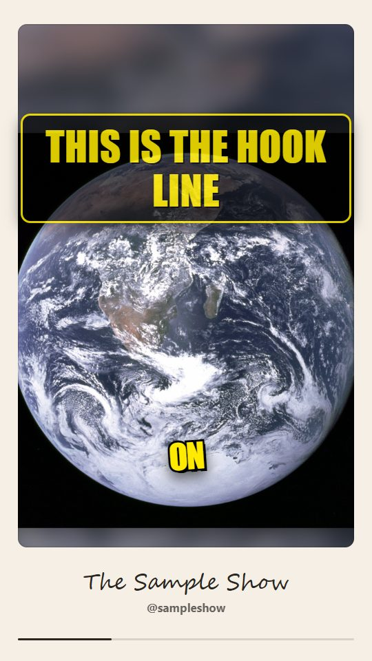
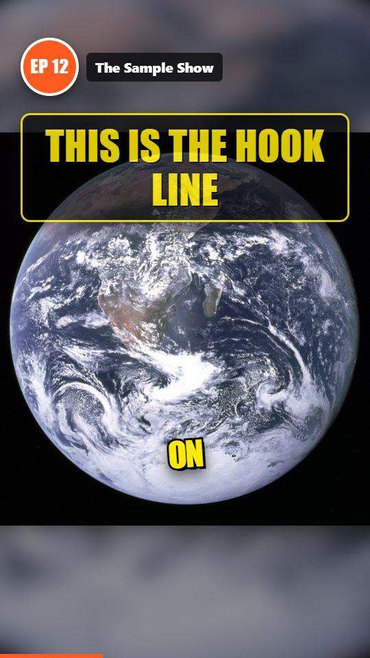
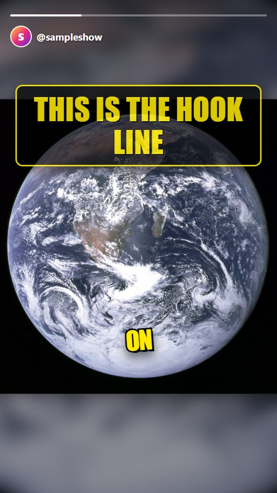

# Templates and looks

Ready-made ways to shape a video. Each is a choice, not a fixed layout: where it says "from the footage", the tool decides by looking at your videos.

## Trip recap looks (`--mode TRIP --recap_style ...`)

| Style | What you get | Best for |
| :-- | :-- | :-- |
| `auto` (default) | Looks at your videos: mostly widescreen goes cinematic (2.35:1), mostly vertical phone clips go hype (9:16). Prints the reason. | Anything |
| `cinematic` | Travel-film look: 2.35:1 frame, grade from the footage (warm for sand/rock/sunset, cool for water/ice/forest), 0.5 s fades, titles laid over the footage and revealed in stages, small spaced place labels, no black cards. | Camera/drone footage |
| `hype` | A hook line over fast glimpses of the most beautiful shots, then the trip title card and a card per day or stop. | Phone clips, shorts |
| `plain` | Day 1 first, no opening. | Plain diary |

`--recap_aspect 9:16|16:9|2.35:1` overrides the frame shape. `--music file` makes cinematic cuts land on whole beats. `--recap_hook "Worth the early start"` sets the opening line. `--trip_stops "A, B, C"` names the stops of a one-day tour. Without it, places are read from the videos' GPS and named as attractions (`--recap_no_geocode` turns the name lookup off). `--recap_versions both` renders a portrait and a landscape recap.

How a cinematic title is decided: the tool reads a frame of the shot under it, puts the text in the calmest area (centre, left, lower or upper), uses light or dark text by brightness there, takes the accent colour from the shot, and rotates the layout (centred, left-aligned, stacked words) so the titles are not all alike.

## Clip templates (`--auto_edit NAME`, `--edit_strength subtle|medium|hyped`)

One choice sets the pause and um cuts, captions, zooms, cutaways, teaser opening, colour and sound effects for a kind of video. Your own flags always win. A summary of what was done is written to `edit_plan.json`. In the browser app it is the "Auto-edit style" list.

| Template | Feels like |
| :-- | :-- |
| `podcast` | Clean and calm: pauses and ums cut, subtitle bar, a teaser, gentle zooms |
| `hype` | Fast and loud: karaoke captions with emoji, frequent zooms, cutaways, punchy colour |
| `educational` | Clear: subtitle bar, stock cutaways, zooms on numbers, no teaser |
| `vlog` | Warm and personal: glow captions, warm grade, teaser |
| `minimal` | Quiet and tidy: plain captions, no zooms, no teaser, no sound effects |
| `news` | Straight: subtitle bar, headline-style hook, cutaways, numbers pop out |
| `storytime` | Moody and close: glow captions, dark grade, teaser |
| `motivation` | Bold: big captions, teaser, frequent zooms, a hit on every cut |
| `tutorial` | Steady: subtitle bar, zooms on numbers, no cutaways, whole picture shown (`fit`) |
| `cinematic` | Film look: plain captions, warm teal-orange grade, teaser, quiet whooshes |

### Make your own template

In the browser app (Start here), open **Save these settings as my template**, type a name and press the button: the Auto-edit style, caption style, extras, colour grade, visual template and covers you chose are saved as `~/.shortsflow/templates/<name>.json` and appear in the Auto-edit list at once. A built-in name cannot be used, and saving again under your own name replaces that file. You can also write the file by hand:

Put a JSON file in `templates/` (next to the program) or in `~/.shortsflow/templates/` (or the folder in the `SHORTSFLOW_TEMPLATES` environment variable). The file name is the template's name (`my-channel.json` gives `--auto_edit my-channel`); it then appears in the command line and in the browser app list. `templates/_example.json` shows every setting; files starting with `_` are ignored. List only what you want to change and name a starting point with `based_on` (a built-in or another of your templates).

```json
{ "label": "My channel", "based_on": "podcast", "caption_style": "GLOW_BOX", "caption_emoji": true,
  "video_filter": "cinematic_warm", "sfx": { "zoom": "pop", "cut": null } }
```

Settings: `label`, `about`, `based_on`; true/false switches `tighten`, `remove_fillers`, `clean_audio`, `caption_emoji`, `hook_overlay`, `cold_open`, `auto_zoom`, `broll`, `stat_pops`; `caption_style` (HORMOZI, GLOW_BOX, BOUNCE, MINIMAL, KARAOKE, NEON, BAR); `video_filter` (null or a named look such as `moody_dark`, `teal_orange`, `cinematic_warm`); `layout` (single, split, active, fit, split_filler); `sfx` with `zoom`, `broll`, `cut`, `stat` each null, `whoosh`, `pop` or `hit`. A wrong value skips that file with a warning that says what to fix; the others still load. A template with a built-in's name replaces it.

## Frame shapes (`--aspect_ratio`)

Clips cut from a video (`--source_video`) can be 9:16 vertical (default), 1:1 square, 4:5 or 16:9 landscape. The face-tracked crop takes the largest window of that shape, the layouts (`single`, `fit`, `split`, `active`, `split_filler`) fill that frame, and the captions, hook title, visual templates and covers follow it.

| Shape | Size | Good for |
| :-- | :-- | :-- |
| `9:16` | 1080x1920 | Shorts, Reels, TikTok |
| `4:5` | 1080x1350 | Instagram and Facebook feed |
| `1:1` | 1080x1080 | Square feed posts |
| `16:9` | 1920x1080 | YouTube, LinkedIn, the web |

```bash
shortsflow clip interview.mp4 --captions --aspect_ratio 1:1 --visual_template neon-frame
```

The layouts were designed for vertical frames, so `split` and `active` (two speakers stacked) look best in 9:16 and 4:5. In 16:9 a landscape source is simply not cropped. Photo reels and the idea-to-video modes still make 9:16.

## Visual templates (`--visual_template NAME`)

A designed skin drawn over the picture, under the hook title and the captions. Needs the animated renderer (`--use_remotion` is turned on for you). Text slots are optional: only the text you give is drawn, nothing is made up.

| Template | Look |
| :-- | :-- |
| `podcast-card` |  Speaker name tag that slides in, show chip, soft shading, progress bar |
| `neon-frame` |  Glowing neon border, progress line along the top, handle chip |
| `news-banner` |  Label and headline bar, scrolling ticker, progress bar |
| `minimal-line` |  A hairline progress bar and a small handle |
| `title-bars` |  Solid headline band on top, handle band at the bottom (the classic title-over-video format) |
| `retro-vhs` |  Scanlines, blinking REC light, running timecode, PLAY label |
| `film-bars` |  Letterbox bars with a small serif title card that fades in and out |
| `polaroid` |  Cream mat around a rounded picture, handwritten line and handle |
| `episode-badge` |  Round number badge (`--template_text label="EP 12"`) with the show name, for series |
| `story-progress` |  Thin story-style progress bar with a round initial and the handle |

```bash
shortsflow clip interview.mp4 --captions --visual_template podcast-card   --template_text speaker="Alex Morgan" --template_text role=Host --template_text show="My Show"   --template_text cta="Follow @myshow for more" --template_accent "#FFB703"
```

Slots: `speaker`, `role`, `show`, `handle`, `headline`, `label` (the badge text on `episode-badge`, the small tag on `news-banner`), `cta` (a closing line over the last 2 seconds). Each design uses the slots that suit it and ignores the rest. The designs and covers follow the frame shape: they are made for 9:16 and adapt to 16:9, square and 4:5 (landscape previews: `docs/templates/<name>-wide.jpg`, made with `PREVIEW_SIZE=1920x1080 python scripts/render_template_previews.py`). A clip template of your own can pick a visual template with `"visual": "podcast-card"`. The previews above are made by `python scripts/render_template_previews.py` on a public-domain NASA photo with made-up sample text.

## Intro and outro transitions (`--intro_animation`, `--outro_animation`)

A cover that opens over the first second of each clip and closes over the last one. Pick one effect for the start and one for the end (they can differ), and a colour with `--animation_color "#6D28D9"` (default dark). They work with or without a visual template, and need the animated renderer (turned on for you). The captions start under the cover, so the first words appear as it opens.

| Effect | Start of the clip | End of the clip | Preview |
| :-- | :-- | :-- | :-- |
| `tiles` | A grid of tiles breaks apart from the centre and flies away | Tiles fly back in and join | [anim-tiles.mp4](templates/anim-tiles.mp4) |
| `panels` | Two doors slide apart | The doors close | [anim-panels.mp4](templates/anim-panels.mp4) |
| `iris` | A circle opens | The circle closes | [anim-iris.mp4](templates/anim-iris.mp4) |
| `blinds` | Horizontal slats open one after another | The slats close | [anim-blinds.mp4](templates/anim-blinds.mp4) |
| `fade` | Fades in from the colour | Fades out to the colour | [anim-fade.mp4](templates/anim-fade.mp4) |

```bash
shortsflow clip interview.mp4 --captions --visual_template neon-frame --intro_animation tiles --outro_animation tiles --animation_color "#0B0C10"
```

A clip template of your own can set `"intro_animation"` and `"outro_animation"`. These are the start and end of each clip; effects between cuts inside a clip are not built yet. Previews: `python scripts/render_template_previews.py --animations`.

## Transitions between background clips and photos (`--segment_transition`)

For photo reels and the idea-to-video modes that use several background clips or photos, the joins can use Remotion's own transitions (the `@remotion/transitions` package). The default stays the plain crossfade. The cut times do not move, so captions and voice stay in step.

`fade`, `slide` (the next picture pushes the old one away), `wipe`, `flip`, `clock-wipe`, `iris`.

```bash
python main.py --mode FACTS --category "space mysteries" --use_remotion --segment_transition slide
```

Vertical clips cut from a long video are one continuous picture, so this does not apply to them; use `--intro_animation` / `--outro_animation` there. The package also offers shader-based looks (cross-zoom, ripple, film burn and others); they need a newer browser feature and are not enabled.

## The highlights video (`--extract_mode long`)

The compiled highlights video is a long landscape (16:9) video joined by FFmpeg, so it cannot be drawn frame by frame in the animated renderer (a 10 minute video is 18,000 frames). Instead, short transparent pieces are rendered for its start and end and laid over it in one FFmpeg pass.

| | Highlights video | Vertical clips |
| :-- | :-- | :-- |
| Transitions between moments | Yes: `--transitions` with `dissolve`, `punch`, `whip`, `flash`, `glitch`, `mix` and the FFmpeg looks `iris`, `blinds`, `panels`, `wipe`, `radial`, `slice`, `pixelize`, `squeeze` | Pieces of one clip only |
| Intro and outro covers (`--intro_animation`, `--outro_animation`) | Yes: first and last second | Yes |
| Visual template (`--visual_template`) | Opening piece (first 7 s: name tag, headline) and closing piece (last 3 s: closing line). Always-on elements (progress bar, frame, bars) show in those two pieces only | Whole clip |
| Captions | Plain burned-in words with `--reel_captions` | Animated styles |
| Clip templates (`--auto_edit`) | Only the default transition of the style | Yes |
| B-roll | Not yet | Yes |

The whole video is re-encoded once for the overlay (audio is copied); the time depends on the length and the PC. If the overlay cannot be made, the video is left as it was and a warning says why.

The FFmpeg looks are for the highlights video only; a recap or a clip gets plain cuts. FFmpeg cannot do the flying-tiles effect (`pixelize` is the closest).

## Photo reel types (`--mode PHOTO_REEL --reel_type ...`)

`memories`, `travel`, `product`, `then_now`, `countdown`, `tribute`: each sets order, timing, captions, title and look. Blurry and duplicate photos are skipped.

## Explainer beats (`python -m engine.explainer_template beats.json out_dir`)

Each beat has a sentence and one ready-made Manim visual: `title`, `counter`, `sigma`, `scale`, `bullets`. The narration is voiced first and each visual lasts as long as its sentence.

## Caption styles (`--caption_style`)

Fourteen animated styles (Remotion, see `remotion-video/src/`). Previews: `assets/caption_previews/<STYLE>.jpg`, shown in the browser app's picker.

| Style | Look |
| :-- | :-- |
| `HORMOZI` | Bold yellow capitals with a heavy outline, one word at a time |
| `GLOW_BOX` | One word in a glowing pink box |
| `BOUNCE` | Bouncy gold capitals |
| `MINIMAL` | Clean dark boxes, the spoken word lit |
| `KARAOKE` | A colour sweeps along each word |
| `NEON` | Neon glow on the spoken word |
| `BAR` | A subtitle bar with the spoken word coloured |
| `MARKER` | A highlighter box sweeps behind the spoken word |
| `SOFT` | Clean sentence case, each word fades in as it is said |
| `WORDCUT` | Bold sentence case, each word cuts in on its beat |
| `NEGATIVE` | White capitals with the longest word (the keyword) in a muted tan |
| `HANDWRITTEN` | Script lettering (Caveat) with an underline drawn under the spoken word |
| `SIMPLE` | Tall plain capitals, one or two words |
| `TYPEWRITER` | Typed out letter by letter in a monospace face (JetBrains Mono), with a blinking cursor |

`AUTO` and `RANDOM` choose among the first four. Fonts are bundled (Anton, Noto Sans, Caveat, JetBrains Mono; all SIL Open Font Licence) and `--caption_color` sets the accent of every style.
