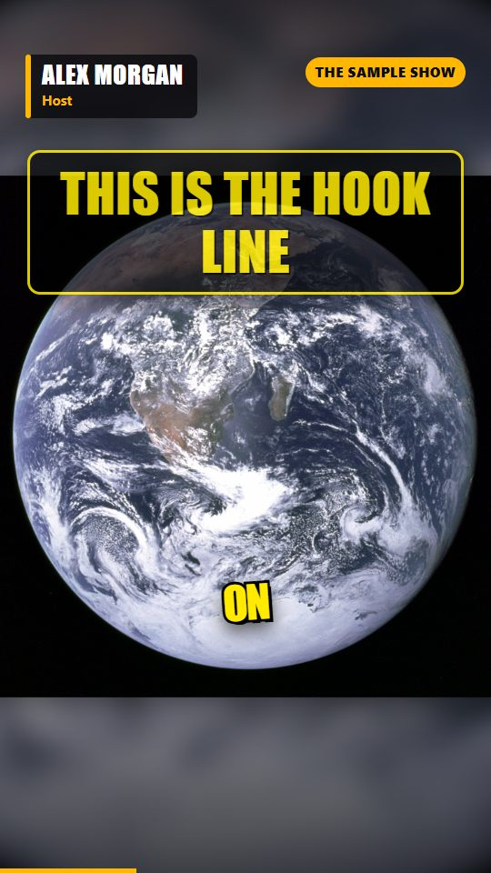
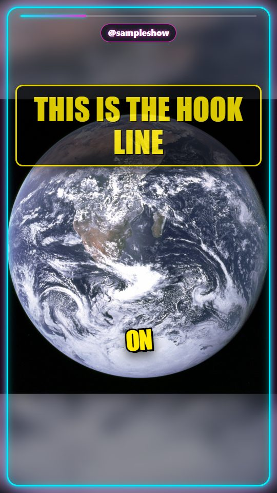
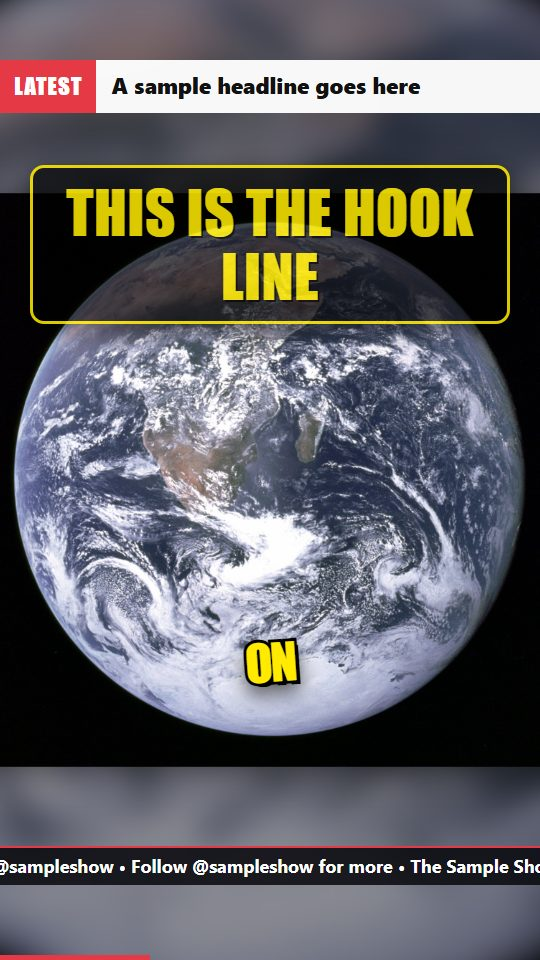
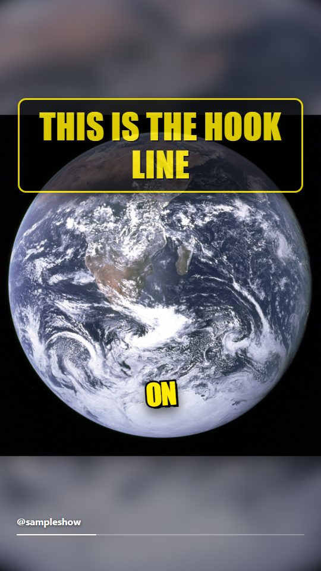

# Templates and looks

Ready-made ways to shape a video. Each is a choice, not a fixed layout: where it says "from the footage", the tool decides by looking at your videos.

## Trip recap looks (`--mode TRIP --recap_style ...`)

| Style | What you get | Best for |
| :-- | :-- | :-- |
| `auto` (default) | Looks at your videos: mostly widescreen goes cinematic (2.35:1), mostly vertical phone clips go hype (9:16). Prints the reason. | Anything |
| `cinematic` | Travel-film look: 2.35:1 frame, grade from the footage (warm for sand/rock/sunset, cool for water/ice/forest), 0.5 s fades, titles laid over the footage and revealed in stages, small spaced place labels, no black cards. | Camera/drone footage |
| `hype` | A hook line over fast glimpses of the most beautiful shots, then the trip title card and a card per day or stop. | Phone clips, shorts |
| `plain` | Day 1 first, no opening. | Plain diary |

`--recap_aspect 9:16|16:9|2.35:1` overrides the frame shape. `--music file` makes cinematic cuts land on whole beats. `--recap_hook "Worth the early start"` sets the opening line. `--trip_stops "A, B, C"` names the stops of a one-day tour. Without it, places are read from the videos' GPS and named as attractions (`--recap_no_geocode` turns the name lookup off). `--recap_versions both` renders a portrait and a landscape recap.

How a cinematic title is decided: the tool reads a frame of the shot under it, puts the text in the calmest area (centre, left, lower or upper), uses light or dark text by brightness there, takes the accent colour from the shot, and rotates the layout (centred, left-aligned, stacked words) so the titles are not all alike.

## Clip templates (`--auto_edit NAME`, `--edit_strength subtle|medium|hyped`)

One choice sets the pause and um cuts, captions, zooms, cutaways, teaser opening, colour and sound effects for a kind of video. Your own flags always win. A summary of what was done is written to `edit_plan.json`. In the browser app it is the "Auto-edit style" list.

| Template | Feels like |
| :-- | :-- |
| `podcast` | Clean and calm: pauses and ums cut, subtitle bar, a teaser, gentle zooms |
| `hype` | Fast and loud: karaoke captions with emoji, frequent zooms, cutaways, punchy colour |
| `educational` | Clear: subtitle bar, stock cutaways, zooms on numbers, no teaser |
| `vlog` | Warm and personal: glow captions, warm grade, teaser |
| `minimal` | Quiet and tidy: plain captions, no zooms, no teaser, no sound effects |
| `news` | Straight: subtitle bar, headline-style hook, cutaways, numbers pop out |
| `storytime` | Moody and close: glow captions, dark grade, teaser |
| `motivation` | Bold: big captions, teaser, frequent zooms, a hit on every cut |
| `tutorial` | Steady: subtitle bar, zooms on numbers, no cutaways, whole picture shown (`fit`) |
| `cinematic` | Film look: plain captions, warm teal-orange grade, teaser, quiet whooshes |

### Make your own template

Put a JSON file in `templates/` (next to the program) or in `~/.shortsflow/templates/` (or the folder in the `SHORTSFLOW_TEMPLATES` environment variable). The file name is the template's name (`my-channel.json` gives `--auto_edit my-channel`); it then appears in the command line and in the browser app list. `templates/_example.json` shows every setting; files starting with `_` are ignored. List only what you want to change and name a starting point with `based_on` (a built-in or another of your templates).

```json
{ "label": "My channel", "based_on": "podcast", "caption_style": "GLOW_BOX", "caption_emoji": true,
  "video_filter": "cinematic_warm", "sfx": { "zoom": "pop", "cut": null } }
```

Settings: `label`, `about`, `based_on`; true/false switches `tighten`, `remove_fillers`, `clean_audio`, `caption_emoji`, `hook_overlay`, `cold_open`, `auto_zoom`, `broll`, `stat_pops`; `caption_style` (HORMOZI, GLOW_BOX, BOUNCE, MINIMAL, KARAOKE, NEON, BAR); `video_filter` (null or a named look such as `moody_dark`, `teal_orange`, `cinematic_warm`); `layout` (single, split, active, fit, split_filler); `sfx` with `zoom`, `broll`, `cut`, `stat` each null, `whoosh`, `pop` or `hit`. A wrong value skips that file with a warning that says what to fix; the others still load. A template with a built-in's name replaces it.

## Visual templates (`--visual_template NAME`)

A designed skin drawn over the picture, under the hook title and the captions. Needs the animated renderer (`--use_remotion` is turned on for you). Text slots are optional: only the text you give is drawn, nothing is made up.

| Template | Look |
| :-- | :-- |
| `podcast-card` |  Speaker name tag that slides in, show chip, soft shading, progress bar |
| `neon-frame` |  Glowing neon border, progress line along the top, handle chip |
| `news-banner` |  Label and headline bar, scrolling ticker, progress bar |
| `minimal-line` |  A hairline progress bar and a small handle |

```bash
shortsflow clip interview.mp4 --captions --visual_template podcast-card   --template_text speaker="Alex Morgan" --template_text role=Host --template_text show="My Show"   --template_text cta="Follow @myshow for more" --template_accent "#FFB703"
```

Slots: `speaker`, `role`, `show`, `handle`, `headline`, `label`, `cta` (a closing line over the last 2 seconds). A clip template of your own can pick a visual template with `"visual": "podcast-card"`. The previews above are made by `python scripts/render_template_previews.py` on a public-domain NASA photo with made-up sample text.

## Photo reel types (`--mode PHOTO_REEL --reel_type ...`)

`memories`, `travel`, `product`, `then_now`, `countdown`, `tribute`: each sets order, timing, captions, title and look. Blurry and duplicate photos are skipped.

## Explainer beats (`python -m engine.explainer_template beats.json out_dir`)

Each beat has a sentence and one ready-made Manim visual: `title`, `counter`, `sigma`, `scale`, `bullets`. The narration is voiced first and each visual lasts as long as its sentence.

## Caption styles (`--caption_style`)

`HORMOZI`, `GLOW_BOX`, `BOUNCE`, `MINIMAL`, `KARAOKE`, `BAR` (Remotion, see `remotion-video/src/`).
